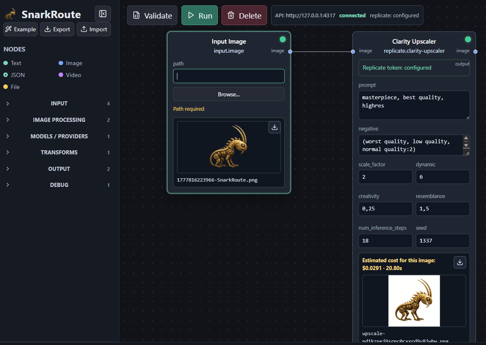

# SnarkRoute

**Local-first orchestration for AI models, agents, tools, compute resources, and portable visual workflows.**

SnarkRoute started as a visual editor for the Open Route Protocol. It has grown into an experimental orchestration platform: a shared model gateway, an agent task dispatcher, resource-aware execution, verification of results, controlled access to local tools, and visual workflow editors.

> **Status: active development / work in progress.** This repository contains working components, prototypes, and integrations developed for a real local workstation. It is **not** yet a polished, turnkey multi-agent product. Implemented code, deployment-specific integrations, and planned capabilities are distinguished below.

## Why SnarkRoute exists

AI systems are increasingly capable of doing work, but the surrounding infrastructure is fragmented. Models, subscriptions, local GPUs, coding agents, creative tools, browser automation, and project state often live in separate applications.

SnarkRoute explores a different approach:

- **Models are replaceable.** Work should not depend on a single provider, subscription, or model.
- **Tasks should outlive chat sessions.** A task needs a goal, state, constraints, evidence, and a verifiable outcome.
- **Agents should cooperate rather than compete for resources.** Routing, quotas, GPU/RAM reservations, and locks belong in shared infrastructure.
- **An action is not a result.** Finishing a model call or clicking a button does not mean the requested work was completed.
- **Tools and workflows should be inspectable and portable.** Visual routes remain part of the architecture, not the whole product.
- **The owner keeps control.** Access to local files, browsers, credentials, external services, and costly actions is subject to explicit policies.

The goal is a practical, local-first environment in which multiple AI agents can use different models and tools while working toward checked results.

## Architecture at a glance

~~~mermaid
flowchart TD
    U["User / Workshop UI / connected agents"] --> Q["Task queue & dispatcher"]
    Q --> R["Capability catalog & executor router"]
    R --> E["Local models / Codex / Claude Code"]
    R --> T["MCP tools / SnarkBridge / local services"]
    Q --> S["Resource leases / quotas / locks"]
    E --> V["Acceptor: checks, reviews & evidence"]
    T --> V
    W["Visual workflows / Open Route Protocol"] --> G["Model Gateway"]
    E --> G
    G --> P["Local and remote model providers"]
    V --> Q
~~~

This is an architectural overview, **not** a claim that all integrations are complete or universally available.

## Main components

| Component | Role | Current state |
| --- | --- | --- |
| **Model Registry & Gateway** | Model metadata, capabilities, provider adapters, selection, invocation, and advisory cost estimates | Implemented core; provider coverage varies |
| **Agent operations (agent-ops)** | Capability catalog, executor routing, persistent tasks, retries, budgets, and delegation | Implemented core; actively evolving |
| **Resource manager** | GPU/VRAM, RAM, CPU and disk reservations; computer-use modes, runtime admission, quotas, and locks | Implemented for the local environment |
| **Acceptor** | Task acceptance criteria, machine checks, model reviews, evidence, and explicit unverifiable states | Implemented; being refined |
| **SnarkBridge integration** | Policy-controlled access to local files, processes, browser sessions, and services | External companion system; deployment-dependent |
| **Workshop launcher** | Local application hub, agent/task views, status, and runtime controls | Working local UI |
| **BoojumRoute Lab** | Visual node editor for portable, executable AI/model/API routes | Working public preview |
| **SnarkRoute Living Canvas** | Higher-level visual creative workspace | Experimental |
| **Autonomous agent applications** | Persistent agents connected through shared tasks and tools | Some running in the author's installation; not all included in this repository |

**Important:** A registered or discovered capability is not the same as an available or verified one. The catalog tracks these states separately. See [agent capabilities and delegation](docs/agent-capabilities-and-delegation.md).

## Agent orchestration

The `apps/server/src/agent-ops` subsystem separates **who can do a task** from **when the task can run**.

- **Capability catalog:** models, coding agents, local services, and tool groups with observed availability.
- **Executor router:** matches a task to an eligible local route, Codex CLI, or Claude Code based on task requirements and policy.
- **Persistent dispatcher:** retains task state, attempts, event history, dependencies, and outcomes across sessions.
- **Resource scheduling:** accounts for GPU and memory pressure, owner activity, shared subscription limits, and conflicting workspaces.
- **Acceptance:** checks the requested result using files, tests, service observations, and review evidence rather than trusting a success message.
- **Delegation:** allows tasks to be handed to other suitable executors under explicit constraints and budgets.

Task contracts include a goal, expected result, constraints, permissions, machine checks, and acceptance criteria. A task can remain blocked or unverifiable rather than being incorrectly called complete.

Detailed design and interfaces: [Agent capabilities](docs/agent-capabilities-and-delegation.md) · [Task Acceptor](docs/agent-acceptor.md).

## Local models, cloud providers, and subscriptions

The Model Gateway abstracts provider-specific calls behind capability-oriented interfaces. The repository includes integrations and infrastructure for local runtimes as well as configured external model providers. Its catalog also supports subscription-backed coding executors in the local deployment.

A few important distinctions:

- A model listed in a catalog is **not** necessarily installed, authenticated, or currently runnable.
- Provider pricing estimates are advisory; unknown costs remain unknown.
- Local heavy inference must respect resource availability and the owner's computer-use mode.
- Subscription execution depends on the corresponding installed CLI, login, eligibility, and quota.
- Nothing in a route file should contain raw provider credentials.

See [Model Gateway v0](docs/model-gateway-v0.md), [model registry principles](docs/model-registry-principles.md), and [agent delegation](docs/agent-capabilities-and-delegation.md).

## The original visual workflow layer

Open Route Protocol (ORP) remains an important part of SnarkRoute. It describes executable graphs of model/API/tool operations as inspectable documents rather than opaque application state.

- `.orp` is the canonical route extension; `.orp.json` and `.orp.yaml` are developer-friendly variants.
- `.route` is a compatibility alias.
- Routes contain nodes, edges, parameters, execution metadata, and asset references.
- `AssetRef` lets a host resolve reusable resources according to its own validation and trust rules.
- BoojumRoute Lab supports editing, validating, importing, exporting, and executing supported routes.
- Reusable `.snarknode` packages describe node capabilities and interfaces; downloaded arbitrary JavaScript is not implicitly trusted.

[Watch the BoojumRoute demo](docs/videos/snarkroute-clarity-demo.mp4) · [Example routes](examples) · [Portable tools and collapsed nodes](docs/portable-tools.md) · [Asset design](docs/assets.md) · [ORP commons principle](docs/commons-principle.md)

Some advanced asset/export features are still incomplete; see the related documentation before relying on them for interchange.

## Getting started (Windows)

The most established public entry point is **BoojumRoute Lab**. The broader Workshop is currently tailored to the author's local environment and its connected services.

Prerequisites: Git, Node.js with Corepack, and a supported Windows development environment.

~~~powershell
git clone https://github.com/Snark-s/snarkroute.git
cd snarkroute
corepack pnpm install
corepack pnpm -r build
~~~

**Start the visual route editor:**

~~~bat
start-boojumroute.bat
~~~

**Start the local Workshop launcher (development setup):**

~~~bat
start-launcher.bat
~~~

Or run individual development targets:

~~~bash
corepack pnpm dev:server
corepack pnpm start:boojumroute
corepack pnpm start:snarkroute
~~~

The relevant local development URLs are:

| Service | Default local URL |
| --- | --- |
| API and MCP endpoint | `http://127.0.0.1:4317` and `http://127.0.0.1:4317/mcp` |
| Workshop launcher | `http://127.0.0.1:5172` |
| BoojumRoute Lab | `http://127.0.0.1:5173` |
| Living Canvas | `http://127.0.0.1:5174` |

These are development defaults, not public endpoints. Do not expose the local API or MCP service to the internet without appropriate authentication and access controls.

**A clean clone will not recreate the author's autonomous agents, browser sessions, local models, external projects, private configuration, or credentials.** Some integrated features require separate installation and configuration.

### Configuration and checks

BoojumRoute Lab can start without third-party API keys. Provider-backed operations need the relevant credentials; use the application's local secrets settings or `.env` based on `.env.example` where supported. Never commit credentials.

~~~bash
corepack pnpm test
corepack pnpm build
~~~

The Workshop also has a consistency checker:

~~~bash
node scripts/passport-check.mjs
~~~

Its checks include assumptions about the author's local setup; missing host-specific paths in another installation are not proof that the entire project is unusable.

For node-package authoring, see the [Boojum node builder skill](docs/boojum-node-builder/SKILL.md).

## Repository map

| Location | Contents |
| --- | --- |
| `apps/server` | API, MCP server, model and agent operations, runtime integrations |
| `apps/launcher` | Workshop launcher and agent/task interface |
| `packages` | Shared protocol, execution, model, and other workspace packages |
| `scripts` | Development tooling, checks, and utilities |
| `examples` | Example Open Route Protocol routes |
| `docs` | Architecture, implementation notes, integration guidance, and ongoing decisions |

Useful starting points for working on the system:

- [Workshop passport](docs/WORKSHOP-PASSPORT.md): system map and development state.
- [Decision registry](docs/decisions/REGISTRY.md): accepted design decisions and proposals.
- [Connecting new entities](docs/CONNECTING-NEW-ENTITY.md): integration rules.
- [Persistent Buzha agent](docs/buzha-agent.md): example of agent/task integration.
- [Repository instructions](AGENTS.md): developer and coding-agent rules.

## What is still in progress?

This is a research-and-development system, not a finished enterprise orchestrator.

- Unifying task storage, schedules, and operational policies across independently developed agent applications.
- Turning every planned agent role into a durable, independently running service.
- Improving integration, packaging, configuration, and portability beyond one Windows workstation.
- Broadening independent verification, diagnostics, and recovery for real-world external actions.
- Continuing the Open Route Protocol asset/export work and the higher-level creative UI.

See the [Workshop passport](docs/WORKSHOP-PASSPORT.md) for known gaps and [visual-workflow roadmap](docs/roadmap.md) for the original protocol/editor roadmap.

## Security and operational boundaries

- Credentials and private data belong in local settings or approved secret stores, **not** committed files or portable routes.
- External websites, retrieved content, and arbitrary downloaded code are not inherently trusted.
- Local tool access is policy-controlled and differs by agent and installation.
- Permission to attempt an operation is not proof that it succeeded.
- Keep the API and MCP endpoint on trusted interfaces unless you have configured suitable protections.
- Model output, external actions, subscription access, and cost estimates may be incomplete or unavailable.

See [SECURITY.md](SECURITY.md) and [security notes](docs/security.md).

## Contributing

Contributions, technical feedback, and discussions about orchestration, reproducible workflows, agent verification, local inference, and interoperable tools are welcome.

Please read [CONTRIBUTING.md](CONTRIBUTING.md) and the [repository instructions](AGENTS.md) before changing code. When modifying Workshop capabilities, follow the documentation and consistency-check conventions described in the [passport](docs/WORKSHOP-PASSPORT.md).

## License

Source code: **AGPL-3.0-or-later**.

Open Route Protocol specifications, documentation, and example routes: **CC BY-SA 4.0**, unless otherwise stated.

User-created outputs are not automatically covered by these project licenses; applicable model, API, service, and asset terms may still apply. Third-party dependencies retain their own licenses. See [LICENSES.md](LICENSES.md).

---

**SnarkRoute is evolving from a node editor into a shared foundation for agents that can find tools, coordinate resources, do work, and demonstrate what they actually accomplished.**

[YouTube](https://www.youtube.com/@SnarkRoute) · [Telegram](https://t.me/snarkroutelab)
