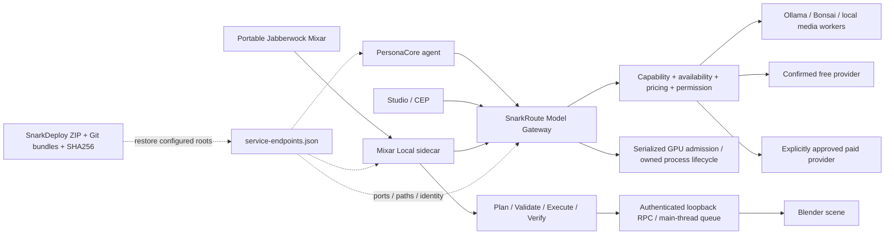

# Аудит SnarkRoute / Jabberwock Mixar / PersonaCore / SnarkBridge

Дата: 11 октября 2026. Изменения выполнены в ветках `codex/stack-stabilization-20261011`. Исходное состояние, включая прежние незакоммиченные правки, сохранено отдельно. Пользовательские сцены не открывались и не сохранялись. Платные генерации и аренда GPU не выполнялись.

## Дефекты и проверки

| Дефект / первопричина | Риск | Исправление | Проверка |
|---|---|---|---|
| Несколько списков портов; Bonsai использовал порт туннеля 8080 | Высокий | Один `service-endpoints.json`; Bonsai 8081; переопределения обязаны совпадать с реестром | Node/Python registry tests; действующие health |
| Открытый TCP/404/ответ другого сервера считался готовностью | Высокий | HTTP 200, отсутствие redirect, identity/API version; для inference — contract и фактический список моделей | D; Bonsai/Ollama/upscale/H3 tests |
| Auto и библиотечные обходы предпочитали Polza/платный маршрут | Высокий | Local First → доступный подтверждённый бесплатный → явное разрешение на платный; неизвестная цена считается платной | Реальная локальная генерация A; отдельный реальный API B; библиотечные контракты |
| Manual/fallback мог изменить смысл выбора и разрешения | Высокий | Manual закреплён; политика проверяется сервером; библиотека не выполняет частный Polza fallback в local | Routing policy и library tests |
| Установленный executor мог обойти политику или выполнить plugin JS | Критический | Запрет plugin executor; декларативные model HTTP операции проходят общий policy check | Installed runner tests; формат ORP/snarknode сохранён |
| H3/Fal/Vast/World Labs и внешние decision backends обходили согласие | Высокий | Одноразовое literal `allowPaid:true`; проверка до запуска/очереди; UI спрашивает согласие, внешний worker включён | Paid media, H3 queue/runtime, decision tests; реальных расходов нет |
| API библиотеки терял routingPolicy и errorDetails | Высокий | Политика передаётся во все пять генерационных обработчиков; код, источник и retryable сохраняются | 44 library tests, включая два новых API сценария |
| 402 провайдера превращался в ошибку собственных кредитов Mixar | Высокий | В local vendor subscription path отключён; ошибка содержит origin/provider/status; исчерпанный провайдер временно исключается | C: mocked upstream HTTP 402 + реальный класс HTTPClient в Mixar |
| Mixar vendor REST/auth/WebSocket/updates обходили локальный маршрут | Высокий | Ранние transport guards; собственный local marker; vendor credentials не читаются/не обновляются; прямые inference порты запрещены | Настоящий portable Mixar: REST, requests, urllib/WebSocket guards; credential spy; локальная генерация через sidecar |
| Общий transport guard разрешал прямые H3/upscale/YuE worker запросы | Высокий | Media inference ports исключены из разрешённых для Mixar transport; запросы проходят SnarkRoute | Три regression subtests и реальный portable requests guard |
| Vendor connector мог открыть CORS `*` scene/export HTTP без аутентификации | Критический | `modules/connector/core/sidecar.py:start_sidecar` запрещён в local до создания listener; используется защищённый RPC | Regression до исправления и настоящий portable импорт/вызов после исправления; vendor cloud behavior сохранён |
| Защищённый RPC клиент читал только plaintext token | Высокий | Общий read-only DPAPI reader для сервера и клиентов; отсутствие ключа блокирует запрос | Настоящий `local_tool_agent._post` с разрешённым ключом владельца |
| Blender RPC допускал браузерные запросы и небезопасную обработку | Критический | Token, loopback Host, Origin/fetch restrictions, JSON limit, очередь main thread, fencing таймаута, ограниченный export root | G/H: реальный Blender HTTP RPC; внешний Origin/Host отклонены; сцена неизменна |
| План/выполнение/проверка смешивались; успешное исполнение считалось достижением цели | Высокий | AST contract, отдельная read-only verification с чтением сцены; константный положительный receipt запрещён; task phases, отказ оптимистичному reporter | E/F: неправильный код отклонён; реальный Cube x=1 против цели x=2 не verified; literal receipt regression |
| Нет сериализации GPU admission / двойные старты | Высокий | Общий admission lock, VRAM checks, identity preflight, ownership, ограниченный supervisor | I: конкурентные admissions и отказы; idle health snapshot; ресурсная гонка без тяжёлого запуска |
| Python venv PID не совпадал с владельцем socket | Средний | Допустим непосредственный дочерний interpreter проверенного venv launcher, с проверкой аргумента сервера | Настоящий перезапуск MCP и identity API v1 |
| Persona health требовал bearer, launcher объявлял живой сервер неготовым | Средний | Публичная только identity health; данные по-прежнему требуют bearer; Host/Origin сохранены | Настоящий /health, реальные HTTP auth tests, 159 Persona tests |
| Медленный Persona startup повторно запускал дочерние процессы | Средний | Хранение собственного pending child; повторные вызовы не создают дубликат; bounded retries | Node regression |
| CEP file-origin конфликтовал с новым HTTP boundary | Средний | Native Node loopback transport в CEP; одноразовый pairing; null Origin разрешён только аутентифицированному AE WebSocket | Server pairing tests, CEP tests и production build |
| Локальные пути содержали mojibake/зависели от прежней буквы диска | Высокий | UTF-8 registry, относительные пути и environment roots; restore перезаписывает registry и pointer | K: relocation tests; L: отдельное восстановление |
| ZIP restore допускал traversal, drive/ADS и выход через symlink | Высокий | Проверка всех members и resolved destination containment, запрет duplicate names | 19 recovery tests: 18 passed; symlink test требует права ОС и был пропущен |
| Snapshot автоматически загружал историю upstream Blender submodule | Средний | Fetch основной Git истории и bundle используют `--no-recurse-submodules` | Regression test; первоначальный незавершённый `.partial` сохранён, действующий архив создаётся заново |
| Restore мог изменить реестр исходной установки через унаследованную environment переменную | Высокий | Явный путь реестра восстановленного SnarkRoute; загрузка canonical document один раз | Relocation regression подтверждает неизменность старого реестра; полный restore probe ограничивает все назначения новым каталогом |

## Конечная схема

Реестр определяет адреса. Готовность определяется контрактом соответствующего сервиса. Наличие локального MCP не доказывает доступность подключённого плагина в ChatGPT; это отдельная внешняя сторона соединения.

Дополнительная проверка подключённого SnarkBridge вернула `Session terminated`, хотя локальная identity health прошла. Регрессионный тест реального FastMCP с прежним session ID после рестарта получил `404 Session not found`. Установленный SDK генерирует `Session terminated` в client transport; вывод о прежней сессии согласуется с этим сценарием. Предложено stateless HTTP для этого scoped bridge, точный diff — `MCP_CHANGE_PROPOSAL.patch`. Автоматическая проверка разрешений отклонила изменение как потенциально меняющее session security; отдельное согласие запрошено. До его получения действующий stateful transport сохранён. Этот отказ подключения нельзя считать устранённым.

## Состав изменений

Полный список и SHA256 до/после: `changes.json`; внешние компоненты: `external-changes.json`; коммиты: `commits.json`. Классифицированные статические network/service call sites Mixar с файлами, функциями и строками: `network-inventory.json`. Это инвентаризация first-party Python, а не перехват всего сетевого трафика native binary. Прежние пользовательские правки в файлах, которые затронул аудит, отделены checkpoint-коммитами. Остальные прежние изменения оставлены в рабочем дереве. Видео и очередь H3 не добавлены в коммиты аудита.

Защищённая локальная сборка находится в каталоге `mixar_runtime` реестра. Она содержит копию исходного Mixar executable с тем же SHA256 и обновлёнными Python модулями. Исходная установка `C:\Program Files\Mixar` не изменена. Загрузка Python overlay через startup оказалась слишком поздней; экспериментальная накладка удалена, рабочее решение применяет политику до vendor imports.

## Проверки и реальные пределы

Автоматические A–D находятся в `apps/server/test/model-routing-integration.test.ts`; они используют контролируемый transport и не обращаются к платным провайдерам. Реальная A: Ollama `llama3:latest`, ответ `OK`, cost 0; JSON сохранён в evidence. Реальная B: отдельный API, два пустых inference порта, пустые provider credentials, `PAID_PERMISSION_REQUIRED`.

E/F/G/H выполнены настоящим portable Mixar/Blender на заводской сцене. Отдельная G/H проверка использовала настоящий sidecar client и DPAPI ключ владельца, созданный только после его явного разрешения. Значение ключа не выводится и в recovery bundle не включается.

J выполнен частично: два новых процесса Blender, настоящий `bpy` theme, постоянные startup assets, hashes неизменны, заводская сцена восстановлена. Отображение всех кнопок, плавающего агента, рамок и масштабирование при разных DPI **не проверены**: native computer APIs недоступны. Полная native C++ сборка также не подтверждена: установленный MSVC 14.41 старше требуемого toolset. Янтарная тема и оригинальный Jabberwock asset существовали до аудита; их сохранение проверено, их создание не приписывается аудиту.

I проверяет admission и concurrency контролируемыми snapshot/launch зависимостями. Одновременно тяжёлые GPU модели специально не запускались. K проверяет перенесённые корни и реестр. Результат полного L вынесен в `recovery-verification.json`.

L выполнен: `X:/SnarkBackups/snark-recovery-20261011-135413.zip` (1 496 708 825 bytes) прошёл SHA256/CRC и проверку members/секретов; все 13 компонентов восстановлены в новый `X:/SnarkBackups/stack-restore-test-20261011`. Registry/pointer направлены только в новые корни, исходный registry не изменился, ключи не перенесены. Восстановленный portable executable прошёл три factory probes: сетевые ограничения, RPC G/H, проверка E/F и тема. Восстановленный API собран и реально выполнил B с `PAID_PERMISSION_REQUIRED`; восстановленный PersonaCore прошёл 159 tests.

Зависимости API установлены по frozen lockfile (386 packages, install scripts выключены); содержимое lockfile не изменилось. Кэш оказался неполным, поэтому закреплённые npm packages потребовали сети. Python runtime/dependencies использованы уже установленные на машине; новая установка Windows, drivers, WSL и weights не выполнялась. Первый повтор PersonaCore с fixtures на одновременно загруженном backup drive получил HTTP timeout 5s и SQLite cleanup lock; повтор с disposable fixtures в рабочем `.tmp` прошёл за 8.9s. Это ограничение диска/fixture workload не скрыто. Итоговый recovery proof создан после ZIP и хранится отдельно от него; ZIP содержит указанные source commits и инструкцию восстановления.

Последние проверки: 23 Node contracts, 23 cross-component Python tests, 159 PersonaCore tests, 72 server tests (включая 44 library tests), 18 recovery tests и один пропущенный symlink test. Server/executor TypeScript build, Studio TypeScript и CEP TypeScript/production build прошли. CEP имеет отдельные 11 focused tests. Vitest из корня запускается с `--exclude '**/.tmp/**'`, чтобы сохранённые до аудита исходники не попадали в текущие тесты.

87 изменённых Python-файлов дополнительно проверены через `compile` без исполнения и записи bytecode. Graphify AST update выполнен без LLM: 11 221 nodes, 24 212 edges; вывод содержит предупреждение о прежнем отсутствующем вложенном корне `SnarkRoute/SnarkRoute` и устаревших community labels. Semantic relabeling не выполнялось.

AST проверка ограничивает допустимый план, но не является полноценной изоляцией Python. Локальный RPC доступен процессам владельца ключа; это доверенные процессы пользователя. Установленные bridge/startup расширения не объявляются вредоносными: их собственные функции сцены, journal, memory sync, cloud tunnel и updater являются штатной функциональностью, требующей явной границы доверия.

## Запуск и восстановление

Практическая инструкция: `RUNBOOK.md`. Воспроизводимые проверки: `scripts/check-local-stack.ps1 -Blender -LiveUnavailable`; тесты TypeScript/Vitest запускаются для изменённых пакетов. Полные логи находятся в локальном `.tmp/audit-20261011`, проверяемые краткие результаты — в evidence.

## Сознательно сохранено

- Переносимый ORP и форматы `.snarknode`, economics/provenance, cloud product behavior. Новая политика действует в локальном режиме; payment permission не превращается в постоянный ключ внутри route или queue.
- Пользовательские сцены, видео, текущие проекты, секреты Mixar/Persona/провайдеров, исходная установка Mixar. Единственный новый production credential — явно разрешённый ключ RPC.
- FreeToken установлен как прежний компонент, но inference service выключен в реестре и не нужен локальному gateway. Legacy direct launch сообщает о необходимой миграции.
- WSL distro/user defaults и большие model weights остаются конфигурацией конкретной машины. Архив хранит инвентарь тяжёлых моделей, а не переносит все веса или GPU драйверы.
- Cloud tunnel не заменён. Запуск и перезапуск MCP отделены от изменения внешней регистрации ChatGPT connector.
- Штатный cloud memory sync PersonaCore сохранён, в local выключен без явного opt-in; пользовательские cloud credentials не менялись.
- Проверка ZIP ищет запрещённые пути и известные текстовые признаки секретов; это не доказательство отсутствия любой произвольной строки секрета внутри всей бинарной Git истории.
